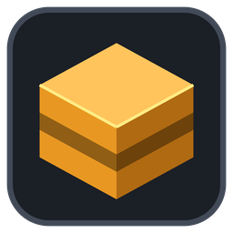
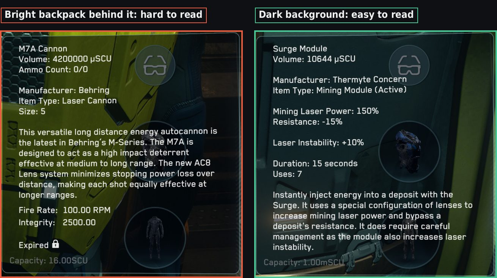
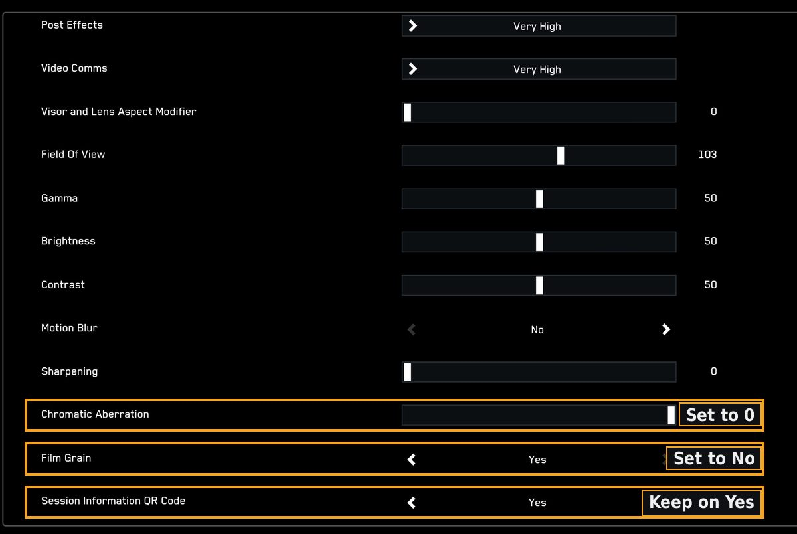
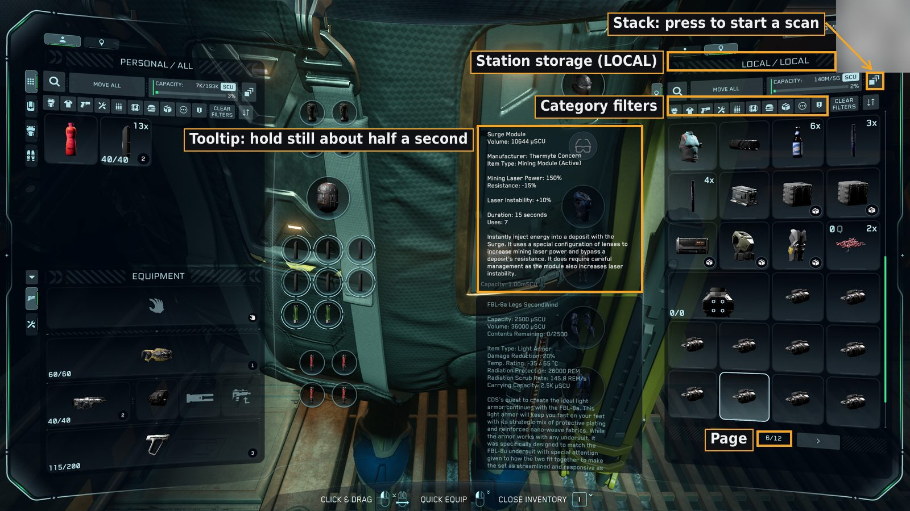
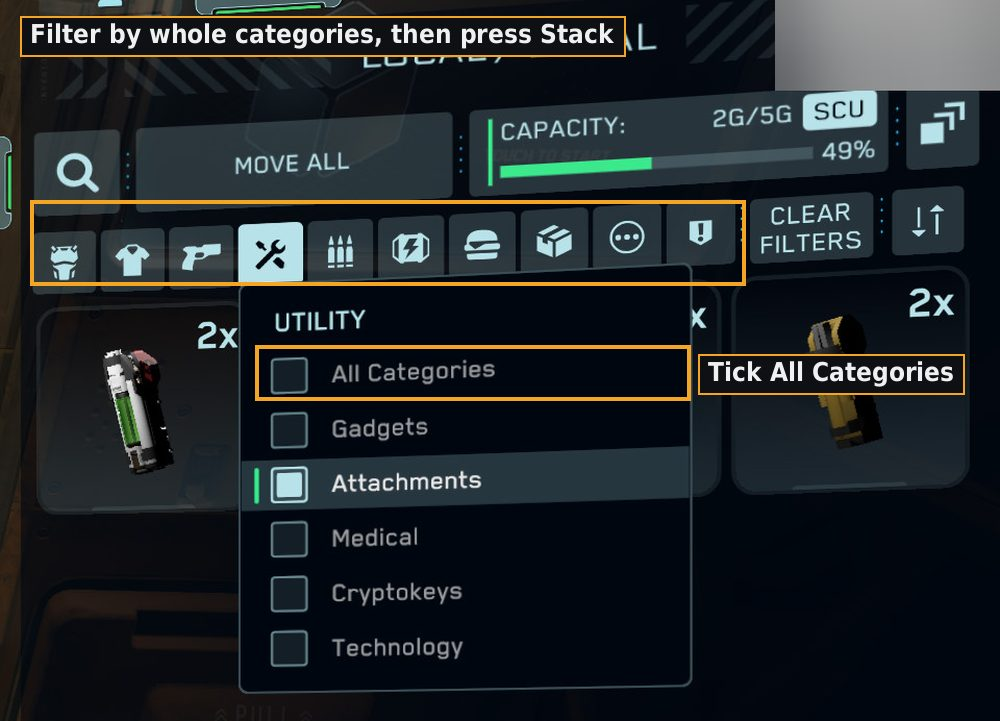
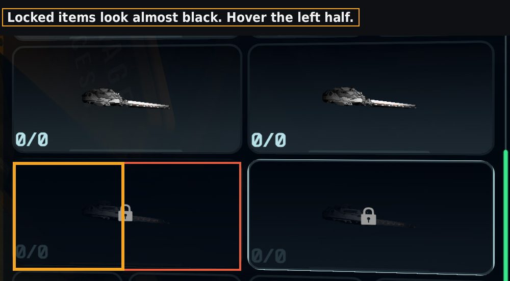
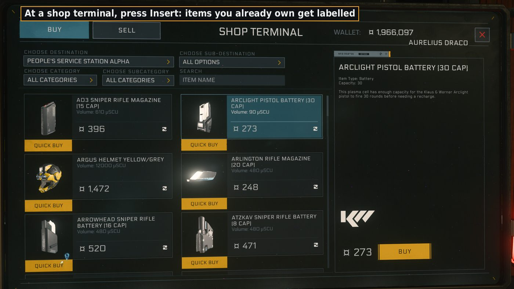
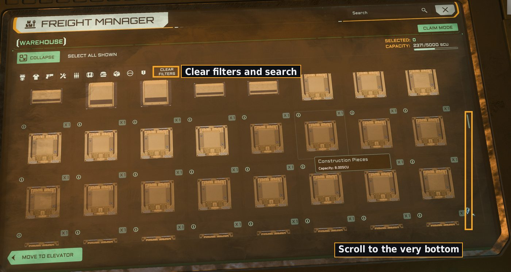

#  SC Inventory Tracker

Keeps track of what you've left in station storage around the Star Citizen
verse. Scan a station's storage kiosk once, and the tracker keeps that station
up to date from the game's own log as you move things in and out, buy things
and sell them. Everything shows up in a dashboard in your browser: search
across every station, see what changed, what things are worth and where to
sell them, and keep wish lists for ship builds and loot.

It runs on your PC only and never touches the game itself.

## What it does

- **Reads the storage kiosk as you hover.** Rest the mouse on each item and the
  tracker reads the tooltip (name, type, size, grade, class), matches it to
  the game's own item names, and marks the tile as done on an overlay. For a
  run of identical items you only hover the first and last.
- **Knows exactly how many items are there** from the freight elevator count
  in Game.log, so you know when a scan is complete.
- **Keeps stations current between scans.** The game logs every move in and
  out of station storage and every shop purchase, with the item and quantity.
  The tracker reads those logs, including sessions when it wasn't running.
- **Dashboard** (runs locally at http://127.0.0.1:8765): search, filters,
  totals per station, how old each station's data is, notes and tags, changes
  you record by hand ("sold 40 gold"), wish lists, best sell spots and
  cheapest buy spots with the date each price was reported, and side by side
  comparisons for ship components.
- **Ships:** add the ships you fly from the full ship list, see each part slot
  with its stock part, plan your fit from everything that fits (stats, cheapest
  price, what you already own), and send the parts you want to your wish list.
- **Wish lists that tell you how to get things:** where to buy an item, how to
  craft it and which contracts give the blueprint, which ships come with it
  fitted, and how many you already have and where.
- **Shop helper:** press Insert at a shop terminal and the overlay labels the
  items on screen that you already have in storage.
- **Category filters:** switch on kiosk filters (Weapons, Vehicles...) before
  you scan to cover just those, and the result slots into your last full scan.
- **Files you can use anywhere:** `inventory.json` (documented in
  [docs/inventory-format.md](docs/inventory-format.md)), plus CSV files for Excel.
- **AI ready:** [ai/instructions.md](ai/instructions.md) lets any AI assistant
  read your inventory and help sort keep/sell/bin, plan pickups, or check an
  Erkul loadout against what you already own.

## Is it safe to use?

- It only reads your screen, Game.log and the game's text file. It never touches the game's memory or network traffic, and never sends mouse or keyboard input.
- Nothing about you leaves your PC. The only network use is fetching public item data and prices from api.star-citizen.wiki, by item id, and you can turn that off in Settings.
- The dashboard only answers this PC (127.0.0.1).
- Not affiliated with or endorsed by Cloud Imperium Games. Star Citizen is a trademark of Cloud Imperium Rights LLC.

It works the same way as other community tools that read Game.log or the
screen. It doesn't automate anything: you do the hovering.

## What you need

- Windows 10 or 11
- Star Citizen in **borderless windowed** mode
- Python 3.12 or 3.13 (setup tells you how to get it if it's missing)
- Any 16:9 screen should work as is. It's been used at 4K and checked with
  screenshots scaled to 1440p and 1080p; reports from real 1440p and 1080p
  screens are welcome. Ultrawide and other shapes need a one-minute
  calibration: `tracker.py --calibrate`.

Linux: the dashboard and log tracking are plain Python and should work, but
reading the kiosk screen isn't supported yet (see the roadmap).

## Install

1. Download the latest release from
   [Releases](https://github.com/Aurelius-Draco/sc-inventory-tracker/releases)
   (or Code, then Download ZIP) and unzip it anywhere, for example next to
   your StarCitizen folder.
2. Double-click **Setup.bat**. It creates a private Python environment in the
   folder, downloads the text reader (about 100 MB) and makes shortcuts with
   icons. Say Y if you also want them on the desktop and in the Start menu.
   If you move the folder later, run Setup.bat again to fix the shortcuts.
3. If your game isn't in a standard place, open `data\config.json` after the
   first run and set `game_dir` to your `StarCitizen\LIVE` folder.

## Use

**Scanning a station:** start **SC Inventory Tracker**, open the storage kiosk in game and
press its **Stack** button. That starts a fresh scan. Hover the items, page by
page. Green dots are done, blue dots were filled in, amber outlines still need
a hover. A chime means a page is complete. Ctrl+C in the tracker window stops
it and prints anything still missing.

**Exact total:** open the freight elevator terminal, clear filters and
scroll its list to the bottom. The tracker takes the exact count from the log.

**Looking things up:** open **SC Inventory Dashboard** (or just leave the
tracker running: the dashboard runs alongside it).

**Other shortcuts:** *SC Inventory Tracker (no overlay)* skips the on-screen
markers if your PC is short on power, and *SC Inventory Screenshot Reader*
reads kiosk screenshots you took in game. The batch files behind every
shortcut are in the `launchers` folder.

**From the command line** (handy for AI assistants with a shell):

```
tracker.py --where "Ripper"                        which stations hold it
tracker.py --adjust "Alpha" "Gold" -40 --note "sold at Levski"
tracker.py --rename-station "Kaboos" "QV Kaboos"
tracker.py --export                                rewrite the files in data\
tracker.py --calibrate                             fit a non-16:9 screen
tracker.py --help
```

## Tips for good scans

### Before you scan

- Take your backpack off, or at least anything bright. The item tooltip appears over your character, and a yellow or white backpack behind it makes the text much harder to read.
- Run the game in borderless windowed mode so the tracker can see the screen.
- Graphics: set Chromatic Aberration to 0 and turn Film Grain off. Keep "Session Information QR Code" on, it lets the tracker date screenshots.
- Turn the overlay off in Settings if your game stutters while the tracker runs. Clicks and chimes still work.





### Starting a scan

- Open the storage kiosk, then press its Stack button. That starts a fresh scan (you'll hear a chime).
- Stack sometimes needs a few presses before it works. Presses close together count as one.
- Check the list looks complete before you start. The kiosk sometimes leaves items out (crates are the usual ones). If something you know you have is missing, press Stack again or close and reopen the kiosk.
- Keep the right panel on your station's storage (LOCAL). Don't change the sort order mid-scan.
- Only after some of your things? Switch on one or more category filters (Armor, Weapons, Vehicles and so on) before you press Stack. The tracker sees which are on, scans just those, and slots the result into your last full scan. Use a whole category (All Categories in its menu), not part of one. Changing a filter mid-scan starts a fresh scan of the new selection.





### Scanning quickly

- Rest the mouse on each item for about half a second. A click sound and a green dot mean it's recorded.
- For a run of identical items, hover only the first and the last. Everything between is filled in (blue dot) because the kiosk sorts by name. It works across pages too.
- Amber outlines are tiles still to hover. Scroll each page to the bottom so the tracker sees every tile. Scrolling back and hovering again never double counts.
- Locked (expired) items still need a hover so the count comes out right. For a two-slot locked item, hover its left half.
- If a name comes out cut off, the tooltip was still appearing. Hold still a moment longer; the tracker has another look by itself. Press Insert to force a capture.
- Don't move items in or out, stack, or use the freight elevator while scanning. The list changes and the scan starts again.



### At shops

- At a shop terminal, press Insert and the overlay labels every item on screen that you already have in storage, with how many and where. Set it to automatic in Settings if you don't mind the extra CPU.



### Getting the exact total

- Open the freight elevator terminal, clear any filter or search, and scroll its list to the very bottom. The game logs the exact item count and the tracker uses it to confirm the scan is complete.



### Between scans

- Items you move in or out of station storage, and things you buy at shops, are picked up from the game's log automatically, even for sessions when the tracker wasn't running.
- The log can't see freight elevator moves or which commodity you sold. The dashboard flags those so you can fix them by hand or rescan.
- A fresh scan always replaces earlier edits for that station, because a scan shows what's really there.
- If Excel has a CSV file open, the tracker can't update it. Close it and it updates next time.

## Files

Everything the tracker writes lives in the `data` folder:

| file | what's in it |
|---|---|
| `inventory.json` | everything, for other tools and AI assistants |
| `summary.csv` | one row per item per station |
| `inventory.csv` | every kiosk tile from each station's last scan |
| `changes.csv`, `expired.csv` | changes since each scan, and locked items |
| `inventory.db` | the full history (SQLite) |
| `config.json` | settings |
| `locations.json` | your own names for stations, if you rename any |

## Useful sites

### Ship loadouts

- [Erkul](https://www.erkul.games): Build, compare and share ship loadouts. Check the parts here before you buy.
- [SPViewer](https://www.spviewer.eu): Ship performance and loadout comparisons.
- [Star Citizen Armory](https://armory.thespacecoder.space): Plan a personal (FPS) loadout and get a shopping list.

### Prices, trading and hauling

- [UEX](https://uexcorp.space): Commodity and item prices reported by players, trade and mining routes.
- [SC Trade Tools](https://sc-trade.tools): Trade and mining routes, commodity prices, refinery yields.
- [SC Hauling Tools](https://sc-hauling.tools): Stop and delivery order for hauling contracts.

### Finding items, missions and crafting

- [Cornerstone Item Finder](https://finder.cstone.space): Where to buy personal and ship equipment, with stats.
- [SC Mission Database](https://scmdb.net): Missions, crafting blueprints, resources and mining.
- [Star Citizen Wiki API](https://star-citizen.wiki): Item data this tracker uses for stats and prices.

### Maps and places

- [VerseGuide](https://verseguide.com): Find locations in the verse.
- [Star Citizen Maps](https://maps.adi.sc): 3D ship interiors with points of interest.

### Wikis and lists

- [Star Citizen Tools wiki](https://starcitizen.tools): Community wiki, including a big list of community tools.
- [Roberts Space Industries](https://robertsspaceindustries.com): The official site, Spectrum forums and patch notes.

## Station names

The game's log uses internal ids for places. The tracker turns them into the
names you know using the game's own text, plus a few rules. If a station shows
up wrong, rename it in the dashboard, and please open an issue with the id and
the right name so everyone gets the fix.

## When a patch breaks it

Game updates can move the kiosk around or change its text. If scans stop
working after a patch, open an issue with your screen size, the game version
and a cropped screenshot of the kiosk (crop out chat so other players' names
aren't shown).

## Roadmap

See [docs/ROADMAP.md](docs/ROADMAP.md).

## About


Made by Aurelius_Draco.

I built this to keep track of what I'd left at stations around the verse, and it turned out useful enough to share. It's free and always will be.

The only thing I ask in return: if you see me in game or in chat, say hi, and if you're running team gameplay, invite me along.
<br clear="left">

- [My citizen page on RSI](https://robertsspaceindustries.com/en/citizens/Aurelius_Draco). Add me as a friend or send me a message in game.
- [New to Star Citizen? Sign up with my referral code STAR-VD9W-346V](https://www.robertsspaceindustries.com/enlist?referral=STAR-VD9W-346V). New players get 50,000 UEC to start with when they sign up with a referral code.

### Ships on my wish list

Nobody has to get me anything. But if you're ever feeling generous, these are the ships I'd love to fly. Message me on my RSI page first so we can sort out the gift.

- [Idris-P](https://robertsspaceindustries.com/pledge/ships/aegis-idris/Idris-P) (Aegis Dynamics). A frigate of my own. Dream big.
- [Polaris](https://robertsspaceindustries.com/pledge/ships/polaris/Polaris) (Roberts Space Industries). A corvette with torpedoes and its own hangar.
- [Perseus](https://robertsspaceindustries.com/pledge/ships/perseus/Perseus) (Roberts Space Industries). Huge turret cannons on a gunship hull.
- [890 Jump](https://robertsspaceindustries.com/pledge/ships/890-jump/890-Jump) (Origin Jumpworks). The luxury yacht. Hauling gold in style.
- [Hammerhead](https://robertsspaceindustries.com/pledge/ships/hammerhead/Hammerhead) (Aegis Dynamics). Turrets on every side.
- [Ironclad Assault](https://robertsspaceindustries.com/pledge/ships/ironclad/Ironclad-Assault) (Drake Interplanetary). An armoured hauler that hits back.
- [Reclaimer](https://robertsspaceindustries.com/pledge/ships/reclaimer/Reclaimer) (Aegis Dynamics). Salvage my own construction materials.
- [600i Explorer](https://robertsspaceindustries.com/pledge/ships/600i/600i-Explorer) (Origin Jumpworks). The comfortable way to see the verse.
- [Paladin](https://robertsspaceindustries.com/pledge/ships/paladin/Paladin) (Anvil Aerospace). A proper heavy gunship.
- [Corsair](https://robertsspaceindustries.com/pledge/ships/drake-corsair/Corsair) (Drake Interplanetary). Guns everywhere, built for the frontier.

## Licence

MIT, see [LICENSE](LICENSE). Third-party parts are listed in
[THIRD_PARTY.md](THIRD_PARTY.md).

Not affiliated with or endorsed by Cloud Imperium Games. Star Citizen is a
trademark of Cloud Imperium Rights LLC. The tracker never ships any game
files: it reads your own copy of the game's text on your PC.
